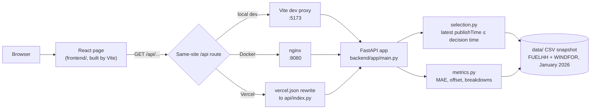

# Wind forecast monitor

[](https://github.com/shingaladeep23-gif/fjbfslkens/actions/workflows/tests.yml)

Shows the national wind generation forecast a GB day-ahead buyer could actually see when they made each January 2026 purchase decision, and measures how accurate it was. Data: Elexon BMRS (FUELHH wind outturn and WINDFOR forecasts).

- **Live app:** https://fjbfslkens.vercel.app
- **Run it yourself:** `docker compose up --build`, then open http://localhost:8080 ([details](#how-to-start))
- **What we found:** [Findings](#findings) below; full analysis in [`analysis/wind_forecast_analysis.ipynb`](analysis/wind_forecast_analysis.ipynb)
- **AI tools:** this project was built with help from AI tools (Claude Code). See [AI tools](#ai-tools).

## Findings

From the notebook (January 2026; its numbers match the app's for the same settings, and a check cell compares them):

- **Accuracy fades slowly with lead time.** The typical miss (MAE) is 1,801 MW one hour ahead, 2,050 MW a day ahead and 2,380 MW two days ahead (16%, 18% and 21% of average output). It worsens fastest between 24 and 36 hours ahead. At the real day-ahead auction time (09:50 the day before) it is 2,107 MW.
- **Most of the miss is a steady offset.** The forecast is about 1.6–2.0 GW above measured output at every lead time, even one hour ahead, and the gap grows with wind. Output never went above 17.8 GW in January, while the forecast often did. This is consistent with curtailment or a difference in which wind farms each dataset covers; it is not proven.
- **A simple correction helps, tested honestly.** Subtracting the average offset learned from December 2025 alone cuts January's day-ahead typical miss from 2,050 MW to 1,343 MW (−35%).
- **What a buyer can count on.** Learned from December: count on about 73% of the day-ahead forecast. In January, output reached that level in 89% of hours, close to the 9-in-10 target, though less reliably when the forecast is very low or very high. The app draws this as a dashed "plan-on" line.

To rerun the notebook: `pip install -r analysis/requirements.txt`, then open it from the `analysis/` folder and run all cells.

## How it works



The page always calls relative `/api/...` URLs, and each setup routes them to the same FastAPI app on the same site, so there is no CORS anywhere. The API loads the CSV snapshot once at startup. For each target hour, `selection.py` picks the latest forecast published at or before the decision time: a fixed lead time before the hour, or 09:50 the day before in day-ahead auction mode. `metrics.py` scores it against the actual output.

## How to start

### With Docker (recommended)

Needs only Docker. From the repo root:

```
docker compose up --build
```

Open http://localhost:8080. nginx serves the page and passes `/api` on to the FastAPI container. The first build takes about a minute and a half; stop with `Ctrl+C`, then `docker compose down`.

### Locally, without Docker

Needs Python 3.11 or newer (CI and Docker use 3.12; the pinned pandas 3.1 needs 3.11+) and Node 22.

#### The API

```
cd backend
pip install -r requirements.txt
python -m uvicorn app.main:app --reload
```

Interactive docs: http://127.0.0.1:8000/docs. All endpoints take `start` and `end` as dates (`YYYY-MM-DD`, whole UTC days, both included, default 1–31 Jan 2026). Where it applies, they also take `lead_hours` (1–48, default 24) and `mode`: `lead` (default, decide `lead_hours` before each hour) or `auction` (decide every hour of a day at 09:50 the day before; `lead_hours` is then ignored). Bad inputs get a 400 with a one-line message.

| Endpoint | Returns |
|---|---|
| `GET /api/series` | Half-hourly actuals and the hourly forecast available at decision time (`null` = gap) |
| `GET /api/metrics` | MAE, RMSE, mean forecast minus actual, error P10/P50/P90, MAE % of mean actual, hours and gaps, plus P10/P50/P90 of actual and forecast output |
| `GET /api/metrics/by-lead` | The same metrics for every lead time from 1 to 48 h |
| `GET /api/metrics/by-hour` | The same metrics for each hour of the day (UTC) |
| `GET /api/metrics/by-level` | The same metrics for each band of actual generation |

#### The front end

Start the API first (see above, port 8000), then in a second terminal:

```
cd frontend
npm install
npm run dev
```

Open http://localhost:5173. In development, Vite passes every `/api` request on to the API on port 8000 (see `frontend/vite.config.js`).

## Running the tests

Back-end unit and API tests (pytest):

```
cd backend
pip install -r requirements.txt
python -m pytest
```

End-to-end browser tests (Playwright, Chromium, 35 tests, about a minute on CI). One command starts the API and the front end itself, then runs the tests:

```
cd frontend
npm install
npx playwright install chromium
npx playwright test
```

To run the same browser tests against an app that is already running, point them at it with `BASE_URL`; Playwright then starts no servers of its own (in PowerShell: `$env:BASE_URL="http://localhost:8080"; npx playwright test`):

```
cd frontend
BASE_URL=http://localhost:8080 npx playwright test           # the Docker app
BASE_URL=https://fjbfslkens.vercel.app npx playwright test   # the live site
```

GitHub Actions runs pytest and Playwright on every push (`.github/workflows/tests.yml`), plus a job that builds the Docker images and checks the API through nginx.

## Deployment (Vercel)

The live app runs on Vercel, built from this repo on every push to `main`:

- `vercel.json` builds `frontend/` with Vite into a static site and rewrites `/api/*` to one Python function, `api/index.py`, which imports the same FastAPI app. The page and API share one domain.
- The function's packages are listed in the root `requirements.txt` with the same pinned versions as `backend/requirements.txt` (a test checks they match). The January CSVs in `data/` are bundled with the function.
- The function runs in London (`lhr1`). Warm API answers take about 0.3 s (measured from India); after the function has been idle for a while, the first request takes about 2.5 s while Python loads pandas and the data (a cold start). Results are cached per function instance.

To deploy your own copy: `npx vercel login`, then `npx vercel deploy --prod` from a clean clone of the repo.

## Layout

| Path | What it is |
|---|---|
| `README.md` | This file |
| `data/actuals.csv`, `data/forecasts.csv` | The January snapshot the app uses: FUELHH wind outturn (half-hourly, 1 Jan – 3 Feb 2026) and WINDFOR forecasts (published 30 Dec 2025 – 31 Jan 2026) |
| `scripts/fetch_data.py` | Refreshes `data/` from the Elexon BMRS API |
| `scripts/fetch_december.py` | Downloads December 2025 into `analysis/data/december/` with the same cleaning, for the notebook only |
| `backend/app/selection.py` | The core rule: the forecast available at decision time (fixed lead or day-ahead auction) |
| `backend/app/metrics.py` | Accuracy metrics (error = forecast − actual) and breakdowns by lead time, hour and generation level |
| `backend/app/main.py` | FastAPI app: loads the CSVs once, checks inputs, serves the `/api/...` endpoints |
| `backend/tests/` | pytest: the selection rule, the metrics, the API, and that the Vercel and back-end package pins match |
| `backend/requirements.txt`, `backend/pytest.ini` | Back-end packages (exact versions) and test setup |
| `backend/Dockerfile`, `backend/Dockerfile.dockerignore` | API image: Python slim, the app code and the January data, uvicorn with 4 workers |
| `frontend/` | React page (Vite, plain JavaScript, Recharts): `src/App.jsx` loads the data, `src/components/` has one file per part of the page, `src/planOn.js` holds the plan-on share, `src/styles.css` is the only stylesheet, `vite.config.js` sets up the dev proxy |
| `frontend/e2e/`, `frontend/playwright.config.js` | Playwright tests, one file per theme (load, controls, charts, failures, layout), with shared helpers in `helpers.js` |
| `frontend/Dockerfile`, `frontend/nginx.conf`, `frontend/.dockerignore` | Page image: built with Node, served by nginx, which passes `/api` on to the API |
| `docker-compose.yml` | Runs the whole app in two containers |
| `api/index.py`, `vercel.json`, `requirements.txt`, `.python-version` | Vercel deployment: the same FastAPI app as a Python function, the Vite site, and `/api` routed to the function |
| `analysis/wind_forecast_analysis.ipynb` | The analysis behind the findings, saved with its outputs so it reads on GitHub |
| `analysis/data/december/`, `analysis/requirements.txt` | December 2025 data (kept out of `data/` so the app stays January-only) and the notebook's packages |
| `.github/workflows/tests.yml` | CI: pytest, Playwright, and a Docker build-and-check job |
| `.gitignore` | Generated files kept out of git (caches, `node_modules`, build output) |

## Assumptions

- **Time zone.** Everything is UTC. In January, UK local time equals UTC.
- **Forecast available at decision time.** For target time T and lead time H, use the forecast with the latest `publishTime ≤ T − H` among forecasts for T. If none exists, the slot is a gap. A gap is never filled with a later forecast, because that would use information the buyer did not have.
- **Default lead time: 24 h.** Nord Pool's N2EX GB day-ahead auction closes at 09:50 UK time the day before delivery ([Nord Pool](https://support.nordpoolgroup.com/support/solutions/articles/8000088463-about-the-day-ahead-gb-auction)). The next day's hours are then about 14–38 h after that decision, so 24 h is close to the middle. Buyers may also trade in other auctions or at other times, so the slider covers 1–48 h.
- **Day-ahead auction mode.** The page can also pick forecasts the way a day-ahead buyer actually decides: every hour of day D uses the latest forecast published by **09:50 on day D−1**, when Nord Pool's N2EX GB day-ahead auction closes. Only the decision time changes; the rule (latest `publishTime ≤ decision time`) is the same. January is GMT, so 09:50 UK time is 09:50 UTC. In summer (BST, UTC+1) the auction would close at 08:50 UTC, and days would start at UK midnight (23:00 UTC), so the code would need a UK time zone conversion.
- **Hourly forecast vs half-hourly actuals.** WINDFOR is hourly and FUELHH is half-hourly. Accuracy metrics compare each forecast only with the actual at the same hour (e.g. the 14:00 forecast with the 14:00–14:30 actual). The :30 actuals are left out of the metrics rather than compared with an interpolated forecast nobody published. The chart still draws every half-hourly actual and draws the forecast as hourly points joined by a line.
- **Error sign.** Error = forecast − actual, so a positive value means the forecast was higher. The average is reported as "mean forecast minus actual", not as bias, until the coverage and curtailment question is checked.
- **Gaps in metrics.** Hours with no forecast are counted and reported, but left out of averages.
- **Same January hours at every lead time.** The brief says "decisions made in January"; we score the same January target hours at every lead so each lead is compared on the same weather, which means early-January targets at long leads use forecasts published on 30–31 Dec.
- **Past hours in a publish.** Each WINDFOR publish restates a few hours before its publish time. Those rows are dropped; they are not forecasts.

## Data notes

- **Publish schedule.** WINDFOR was published 8 times a day in January 2026, at 02:30, 04:30, 07:30, 09:30, 11:30, 15:30, 18:30 and 22:30 UTC. The longest wait between two publishes is 4 h. One publish was off schedule: 12:25 instead of 11:30 (one day out of 33). The API docs list the times as 03:30 … 23:30, exactly one hour later than what the data shows.
- **Forecast horizon.** Every publish runs until 21:00 two days later (Elexon's interface spec: "21:00 on the current day to 21:00 on day+2"). So the real lead time ranges from 0.5 to 66.5 h, but late-evening targets cannot have a forecast at very long leads. Of the 744 January target hours, the number with no forecast is: 0 up to H = 42 h, 31 at 44 h, 93 at 46 h, 155 at 48 h (all between 22:00 and 02:00).
- **Effective lead is longer than H.** Because publishes come every 2–4 h, the forecast picked at H = 24 h was on average (median) made 25.5 h before the target, and at most 27.5 h.
- **Coverage.** WINDFOR covers "wind farms which are visible to the ESO and have operational metering" (BMRS API spec). FUELHH is also built from operational metering. Both leave out small embedded wind farms that have no operational metering.

## AI tools

This project was built with help from AI tools (Claude Code), which were used to write and review code, tests and documentation.
